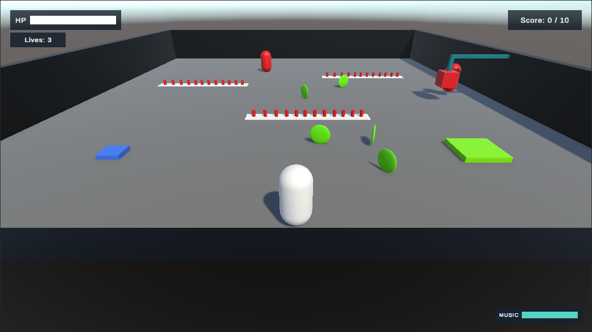
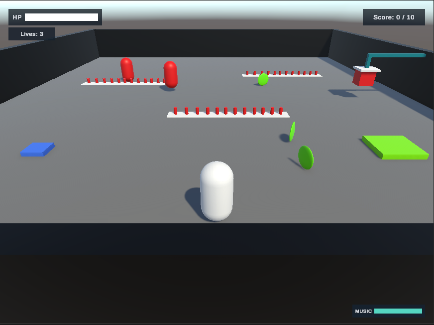
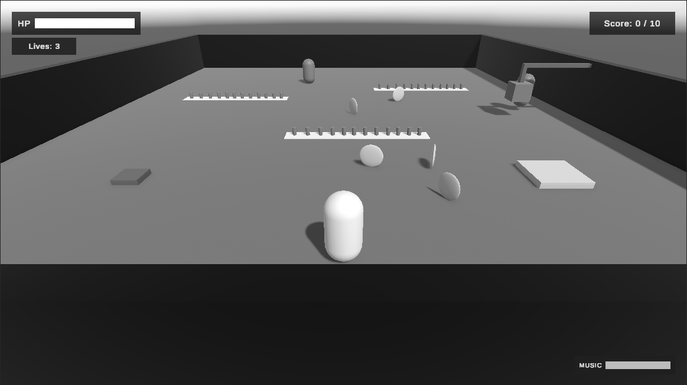

# CS464 Assignment 04 · Tayyab Ahmed Minhas · BSCS25031

**Video (90–180 s):** [YouTube (unlisted) or Google Drive link]

## Settings

| Part | Setting | Value | Why |
|---|---|---|---|
| A | Harmony · base hue | split-complementary · 216° | The blue `#5A95ED` is the base. The red `#E74C3C` and amber `#F9E090` are the warm split-complements, while the cool teal `#55D6C2` keeps the health bar readable. The dark panel, mid button and light text are greys of one value scale. |
| A | Dark · mid · light | `#19222E` · `#5A95ED` · `#EBF0F7` | The panel is dark, the button is the mid value, and the text is light. In grayscale they still read as three separate layers. |
| A | Accents | `#E74C3C` · `#F9E090` | Red marks damage and game over; amber is the paler lag bar behind the teal health fill. |
| A | HUD text on its panel | `#EBF0F7` on `#19222E` — 14.00 : 1 | Measured with the WCAG formula in `ColourUtil.Contrast`. It clears the required 4.5 : 1 for normal text. |
| A | Button label on the button | `#14171C` on `#5A95ED` — 5.95 : 1 | A dark label is used because white on this blue is only 2.64 : 1. The measured pair clears 4.5 : 1. |
| B | Music · SFX groups, as mixed | −3.2 dB · 0 dB | Music sits slightly below effects so a pickup or hit remains audible over it; SFX stays at unity. Both groups are exposed as `MusicVolume` and `SfxVolume`. |
| B | Slider at 1 · 0.5 · 0.0001 | 0 dB · −6 dB · −80 dB | `Mathf.Log10(value) * 20f` maps the 0.0001–1 slider to a perceptual decibel scale instead of a near-silent 0–1 dB range. |
| C | Enemy hum (`hum1.ogg`), in all five levels | Logarithmic · Min 1 m · Max 15 m | A guard is a local threat. Natural −6 dB per doubling tells the player how close it is before it starts chasing. |
| C | Bounce-pad hum (`hum2.ogg`), in all five levels | Linear · Min 2 m · Max 25 m | The pad is a fixed landmark. Linear falloff to silence at 25 m gives a steady, predictable cue while navigating. |
| C | AudioListener | on `AudioListenerRig` with `ListenerOnPlayer` | The follow camera sits several metres behind the player, so the camera's listener was removed. The rig puts the ears at the player and takes rotation from the camera. |
| D | `unlocked` | int · default 1 | Level 1 is always open, and a never-set key must still open it. `SaveData.Unlocked` reads with this default. |
| D | `best1` … `best5` | float · HasKey first | No time exists until a level is won. The menu checks `HasKey` before showing a best, then reads the float. |
| D | `MusicVolume` | float · default 1 | The slider saves its linear value; a fresh install starts at full volume and `MixerApply` converts it to dB. |
| D | `SfxVolume` | float · default 1 | The same rule keeps effects at full volume on a fresh install and lets `SaveData` own the key. |

## Answers

1. **What `Time.timeScale = 0` stops in my game, and what it doesn't:** `Time.timeScale = 0` stops physics steps, movement driven by `Time.deltaTime`, and coroutines waiting on `WaitForSeconds`. It does not stop `Update` itself, unscaled UI input, or `WaitForSecondsRealtime`. That is why the player's `Update` starts with `if (PauseMenu.IsPaused || EndScreens.Over) return;`, and why the loader uses unscaled time while a panel is frozen.

2. **What survives a LoadScene in my game, and how:** Statics such as `PauseMenu.IsPaused`, `EndScreens.Over` and the static `GameEvents` subscriptions survive a `LoadScene` because they live in managed memory, not in the scene. `DontDestroyOnLoad` keeps `SfxPlayer` and `PersistentMusic` alive with their single instances. `PlayerPrefs` also survives on disk. `LevelLoader.Load` resets `Time.timeScale` to 1, and each manager's `Awake` clears the static flags for the new scene.

3. **Why every PlayerPrefs read in my game has a default:** PlayerPrefs returns zero for a missing numeric key, which would look like a real score, time or volume. A win with no saved best would show `0.0 s`; a fresh install would start with zero unlocked levels. `SaveData` therefore reads `unlocked` with default 1, volumes with default 1, and checks `HasKey` before reading `best1`–`best5`. Every read has a value the game can safely display.

4. **An exception a forgotten unsubscribe would throw, and why mine can't:** `GameEvents.CoinCollected` and `GameEvents.PlayerDamaged` are static, so a listener that adds `+=` in `OnEnable` but forgets `-=` in `OnDisable` stays subscribed after a reload. The next coin calls a method on a destroyed object and throws `MissingReferenceException`, or duplicates the score. Every listener here — the bar, `HurtSound`, `HitSparks` and `ScoreListener` — unsubscribes in `OnDisable`, so a restart leaves no stale delegate.

## Credits

- `music.ogg` (`calm_track-loop.ogg`) · pmiller · https://opengameart.org/sites/default/files/calm_track-loop.ogg · CC0 1.0
- `pickup.ogg` · Kenney · https://kenney.nl/assets · CC0 1.0
- `hit.ogg` · Kenney · https://kenney.nl/assets · CC0 1.0
- `click.ogg` · Kenney · https://kenney.nl/assets · CC0 1.0
- `win.ogg` · Kenney · https://kenney.nl/assets · CC0 1.0
- `lose.ogg` · Kenney · https://kenney.nl/assets · CC0 1.0
- `hum1.ogg` · Kenney · https://kenney.nl/assets · CC0 1.0
- `hum2.ogg` · Kenney · https://kenney.nl/assets · CC0 1.0
- `back_001.ogg` · Kenney · https://kenney.nl/assets · CC0 1.0
- `close_001.ogg` · Kenney · https://kenney.nl/assets · CC0 1.0
- `error_008.ogg` · Kenney · https://kenney.nl/assets · CC0 1.0
- `hover.ogg` · Kenney · https://kenney.nl/assets · CC0 1.0
- `maximize_001.ogg` · Kenney · https://kenney.nl/assets · CC0 1.0
- `open_001.ogg` · Kenney · https://kenney.nl/assets · CC0 1.0
- `pluck_002.ogg` · Kenney · https://kenney.nl/assets · CC0 1.0

All audio assets are CC0, so attribution is not legally required; it is included here as courtesy.
